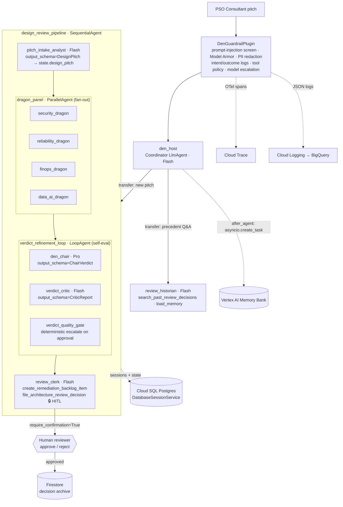

# 🐉 The Dragons' Den: a multi-agent Architecture Review Board for Google Cloud PSO

> *"Your Cloud SQL is zonal, your service-account keys are in CI, and your budget is a work of fiction. I'm out."*
> (the Reliability, Security and FinOps Dragons, in that order)

**Track:** Enterprise Agents · **Built with:** Google Agent Development Kit (ADK 2.14, Python), Gemini 2.5 Flash / Pro, Vertex AI, Cloud Run, Firestore, Cloud SQL, Secret Manager, Sensitive Data Protection (DLP), Model Armor, Cloud Trace, Terraform, GitHub Actions.

---

## 1. Problem → Solution

**Problem.** In Google Cloud Professional Services (PSO), every customer engagement produces architecture designs that need an expert review. Each one needs a security sign-off, an availability check against the SLO, a cost sanity check and a data-governance review. Senior architects are the bottleneck, reviews are inconsistent between reviewers, the evidence (SLA maths, pricing, residency rules) is redone by hand every time, and nobody can easily find *"what did we decide last time someone pitched a single-VM storefront?"*

**Solution.** **The Dragons' Den** turns the architecture review board into a team of AI specialists. A PSO consultant *pitches* a customer design in plain English. Four specialist **dragons** grill it **in parallel**, each grounded in deterministic tools:

| Dragon | Grounding tool | What it checks |
|---|---|---|
| 🛡️ Security Dragon | `scan_design_for_security_antipatterns` | SA keys, primitive roles, open ports, missing WAF/IAP, secrets in code |
| 🧯 Reliability Dragon | `calculate_composite_availability_slo` | Composite SLA maths vs. target SLO, SPOFs, multi-region |
| 💸 FinOps Dragon | `estimate_monthly_gcp_cost` | Monthly bill, budget fit, CUD savings, right-sizing |
| 🧬 Data & AI Dragon | `check_data_residency_compliance` | GDPR/HIPAA/PCI residency, CMEK, VPC-SC, responsible GenAI |

The **Den Chair** (Gemini **Pro**) combines the four opinions into a scored verdict: **"I'm in"**, **"I'm in, with conditions"** or **"I'm out"**, with a Den Score from 0 to 100 and a 30/60/90-day remediation plan. A **Verdict Critic** audits the draft in a self-evaluation loop until it is grounded and consistent. The **Review Clerk** creates the remediation backlog and files the official decision, but only after **explicit human approval** (HITL). Every filed decision becomes searchable **precedent** for future reviews.

---

## 2. Architecture



**Request lifecycle:** the pitch is screened and PII-redacted → the host transfers to the pipeline → intake extracts a strict `DesignPitch` into session state → four dragons run concurrently and write `*_verdict` to state → the Chair drafts and the Critic audits until approved (at most 3 rounds) → the Clerk presents the verdict, creates backlog items and calls the filing tool → **ADK pauses** for human approval → on approval the decision is written to Firestore → memory consolidation runs in the background.

---

## 3. AgentOps Code Review Matrix: evidence map (95 / 95)

| # | Category | Criterion | Where it lives |
|---|---|---|---|
| 1 | **Tool & Interface Design** | Comprehensive tool docstrings | Every tool in [`dragons_den/tools/`](dragons_den/tools) has a purpose, every `Args:` and `Returns:` documented (enforced by `test_tools_have_comprehensive_docstrings`). |
| 2 | | Descriptive naming | `scan_design_for_security_antipatterns`, `calculate_composite_availability_slo`, `estimate_monthly_gcp_cost`, `check_data_residency_compliance`, `file_architecture_review_decision`… (verb_object, enforced by test). |
| 3 | | Explicit JSON schemas | [`dragons_den/schemas.py`](dragons_den/schemas.py): strict Pydantic (`extra="forbid"`) `*Input`/`*Output` for every tool, plus `output_schema` on intake/dragons/chair/critic. Pydantic parameters such as `list[CostLineItemInput]` give the LLM a full JSON schema (`parameters_json_schema`). |
| 4 | | Guided error handling | [`tools/_common.py`](dragons_den/tools/_common.py) `den_tool` turns `ValidationError` and crashes into `GuidedToolError{error_code, recovery_instructions, valid_values, suggested_next_tool}`. The plugin's `on_tool_error_callback` does the same. |
| 5 | **Context & Memory** | Robust system instructions | [`prompts.py`](dragons_den/prompts.py) `DEN_CONSTITUTION` (persona, domain knowledge, Den Score rubric, evidence discipline, hard constraints) is set as `static_instruction` on every agent, and each role has its own instructions. |
| 6 | | History compaction | [`memory/compaction.py`](dragons_den/memory/compaction.py): ADK `EventsCompactionConfig` (sliding window + token threshold, `LlmEventSummarizer` on Flash), `ContextCacheConfig` (Vertex/Gemini context caching), `include_contents="none"` scoping for the specialists, `trim_text_for_state`. |
| 7 | | Persistent session state | [`memory/sessions.py`](dragons_den/memory/sessions.py): `DatabaseSessionService` (Cloud SQL Postgres / SQLite) or `VertexAiSessionService`, plus `VertexAiMemoryBankService`. [`memory/decision_store.py`](dragons_den/memory/decision_store.py): Firestore / SQLite-FTS5 precedent store. The e2e test runs on a persistent SQLite session DB. |
| 8 | | Async memory operations | [`memory/async_memory.py`](dragons_den/memory/async_memory.py): `after_agent_callback` → `asyncio.create_task` (tracked task set), `asyncio.to_thread` for DLP redaction, then `add_session_to_memory`. Verified by `test_async_memory_is_non_blocking`. |
| 9 | **Orchestration & Logic** | Multi-agent patterns | [`agent.py`](dragons_den/agent.py): Coordinator (`den_host` + transfer), `SequentialAgent`, `ParallelAgent` fan-out, `LoopAgent` generator–critic, custom `BaseAgent` gate. |
| 10 | | Strategic model routing | [`config.py`](dragons_den/config.py) `AGENT_ROUTING_TABLE`: Flash for extraction, specialists, critic and clerk; Pro for the Chair. [`guardrails.py`](dragons_den/guardrails.py) escalates a dragon from Flash to Pro at runtime for high-complexity or restricted-data pitches (`MODEL_ROUTING_ESCALATED` log). |
| 11 | | Guardrails & policy plugins | [`guardrails.py`](dragons_den/guardrails.py) `DenGuardrailPlugin(BasePlugin)`: prompt-injection screening, **Google Cloud Model Armor**, PII scrubbing in and out, and a tool policy (no filing before the critic approves). The self-evaluation `verdict_refinement_loop` is the evaluation guardrail. |
| 12 | | Human-in-the-loop hooks | [`tools/decisions.py`](dragons_den/tools/decisions.py): `FunctionTool(file_architecture_review_decision, require_confirmation=True)`, a defence-in-depth `tool_context.request_confirmation` check, and `ResumabilityConfig(is_resumable=True)`. Approve and reject paths are tested end to end. |
| 13 | **Observability & Tracing** | Structured JSON logging | [`observability/logging.py`](dragons_den/observability/logging.py): `JsonFormatter` (Cloud Logging `jsonPayload`, severity, event_type, phase, agent/tool, trace correlation). |
| 14 | | Intent vs. outcome capture | Plugin emits `AGENT_INTENT`/`AGENT_OUTCOME`, `MODEL_INTENT`/`MODEL_OUTCOME` and `TOOL_INTENT` (redacted args) / `TOOL_OUTCOME` (status, latency, error_code). `HITL_APPROVED`/`HITL_REJECTED` are logged too. |
| 15 | | Distributed tracing | [`observability/tracing.py`](dragons_den/observability/tracing.py): OpenTelemetry `TracerProvider` + `CloudTraceSpanExporter`, with ADK's native spans linking invocation → agent → LLM → tool. Each tool adds a `den.tool.*` child span, and logs carry `logging.googleapis.com/trace`. |
| 16 | | PII redaction | [`observability/pii.py`](dragons_den/observability/pii.py): Cloud **Sensitive Data Protection (DLP)** `deidentify_content` plus a local regex/Luhn scrubber. Applied to logs, user messages, model I/O, session state (`pitch_text`), memory and the decision store. |
| 17 | **Infrastructure & CI/CD** | Automated evaluation suites | [`eval/golden_dataset.json`](eval/golden_dataset.json) feeds the offline harness [`eval/run_offline_eval.py`](eval/run_offline_eval.py) (tool goldens, red-team, trajectory; 100% gate in CI), the ADK evalset [`eval/build_evalset.py`](eval/build_evalset.py) with [`test_config.json`](eval/test_config.json) (trajectory, rubric LLM judge, safety), and a nightly `AgentEvaluator` run. 72 pytest tests. |
| 18 | | Infrastructure as Code | [`terraform/`](terraform): APIs, least-privilege SAs, WIF for GitHub, Secret Manager, Firestore, Cloud SQL HA, Artifact Registry, Cloud Run v2, log sink to BigQuery, log metrics, alert policy. ADK/Agents CLI deploys (`adk deploy cloud_run`, `adk deploy agent_engine`) are in the [Makefile](Makefile). |
| 19 | | Secure secret management | [`secrets.py`](dragons_den/secrets.py): Cloud Run `--set-secrets` env injection, with Secret Manager API fallback via ADC. No keys in code, image or tfstate. `test_no_hardcoded_secrets_in_repo` and gitleaks run in CI, and GitHub deploys keylessly through WIF. |

---

## 4. Quickstart

```bash
git clone https://github.com/omarmostafacloud/ai-in-5-days.git && cd ai-in-5-days
python3 -m venv .venv && source .venv/bin/activate
pip install -r requirements.txt
cp .env.example .env            # Vertex AI: set GOOGLE_CLOUD_PROJECT (uses ADC)
gcloud auth application-default login

make test                       # 72 offline tests (scripted LLM, no network)
make eval                       # golden-dataset regression gate (100%)
make web                        # ADK Dev UI at http://localhost:8000, pick "dragons_den"
```

### Demo pitches
Paste one of [`samples/pitches/`](samples/pitches) into the UI. Example:

> *Orbit Retail wants their Black Friday storefront on a single Compute Engine VM running self-managed MySQL. SSH open on 0.0.0.0/0, plain HTTP, internal data in us-central1, 99.9% SLO, \$1,500/month budget.*

You'll watch the four dragons work in parallel in the ADK trace view. The critic then sends the chair's first draft back if it doesn't hold up, and the clerk pauses with an **approval prompt** before anything is filed. Then ask *"what did we decide for Orbit Retail last time?"* to see the precedent search.

---

## 5. Deploy to Google Cloud

```bash
# 1. Provision everything (APIs, IAM, WIF, secrets, Firestore, Cloud SQL, Cloud Run, logging)
cd terraform && cp terraform.tfvars.example terraform.tfvars   # edit project_id
terraform init -backend-config="bucket=<your-tfstate-bucket>" && terraform apply

# 2. Add secret values out-of-band (never in code)
printf '%s' "<token>" | gcloud secrets versions add dragons-den-decision-webhook-token --data-file=-

# 3. Model Armor template used by the guardrail plugin
gcloud model-armor templates create dragons-den --location us-central1 \
  --pi-and-jailbreak-filter-settings-enforcement=enabled --malicious-uri-filter-settings-enforcement=enabled

# 4. CI/CD: set repo variables GCP_PROJECT_ID, GCP_REGION, TF_STATE_BUCKET and secrets
#    GCP_WIF_PROVIDER / GCP_DEPLOYER_SA (terraform outputs). Pushing to main builds, applies and deploys.
```

Alternatives with the ADK CLI: `make deploy-cloud-run`, or `make deploy-agent-engine` (managed sessions + Memory Bank; set `AGENT_ENGINE_ID` to switch the session and memory backends automatically).

---

## 6. Repository layout

```
dragons_den/
  agent.py            # Orchestration graph + App (plugins, compaction, caching, resumability)
  prompts.py          # Constitution + role instructions
  schemas.py          # Strict Pydantic I/O schemas
  config.py           # Settings + strategic model routing
  guardrails.py       # DenGuardrailPlugin (security, policy, PII, routing, intent/outcome)
  secrets.py          # Secret Manager integration
  tools/              # Grounded, schema-validated, traced tools (+ HITL filing tool)
  memory/             # compaction, sessions, decision store, async consolidation
  observability/      # JSON logging, OpenTelemetry, PII redaction
  data/               # Well-Architected principles, SLA/pricing/residency catalog, precedent seed
eval/                 # golden dataset, offline harness, ADK evalset builder + criteria
tests/                # unit, guardrail, e2e orchestration (scripted LLM), live eval
terraform/            # IaC
.github/workflows/    # CI (lint/test/eval/IaC/gitleaks/docker), CD (WIF → Cloud Run), nightly live eval
main.py, Dockerfile, Makefile
```

## 7. Design notes
* **Deterministic grounding.** The dragons' numbers come from rule-based tools, not from LLM memory. That makes verdicts reproducible and lets CI regression-test the facts every verdict depends on.
* **Safe by construction.** Three layers protect the irreversible step: (1) the critic must approve, enforced by the plugin's tool policy; (2) ADK `require_confirmation` pauses the run for a human; (3) the tool body itself refuses to run without a `ToolConfirmation`.
* **Cost-aware.** 9 of the 10 agents run on Flash. Pro is used only for the Chair's synthesis, or when a pitch is complex or regulated enough to need it.
* **ADK 2.x note.** `SequentialAgent`/`ParallelAgent`/`LoopAgent` print a deprecation notice in favour of the new `Workflow` API. Workflows can't yet be used as `LlmAgent` sub-agents, and the coordinator-transfer pattern needs that. Migration is a drop-in once ADK supports it.

## 8. Video walkthrough
See [`docs/video_script.md`](docs/video_script.md) for the 5-minute demo script (problem, architecture, code tour, live demo, AgentOps).

License: Apache-2.0
